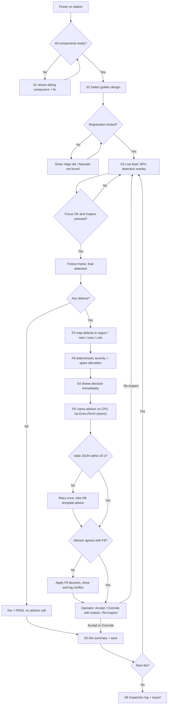
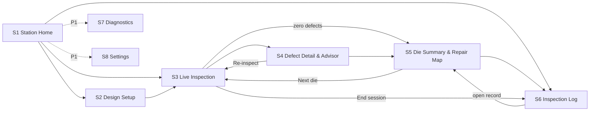

# PRD: Golden-Layout Inspector

**Track:** PS5, Manufacturing & Industry 4.0 (real-time industrial defect detection & QC assistant)
**Input source:** `hackathon-strategy.md`, "Selected Project" (S2, Golden-Layout Inspector) and "Build Constraints" sections.
**Team:** 3 members (AI/ML, SDE, VLSI)
**Status:** Draft v1. Concept fixed upstream; this document expands it and does not redesign it.

**Deadline (confirmed):** Project complete by **Sun 23 Nov 2026**. Work runs from Wed 12 Nov, giving 11 working days (12–22 Nov) plus submission day.

**Capacity assumption:** ~5 hours per person per day alongside OpenRAM and coursework, giving **~165 person-hours (ph)** for the team.

The original Must Have scope (178 ph) does not fit, so this PRD now uses the **Nov-23 lean scope (~154 ph, Section 5)** with dated go/no-go gates (Section 4). If real capacity is closer to 3 h/person/day (~100 ph), only Cut 2 fits; decide this at Gate G1.

---

## 1. Product Vision

### Mission
Turn every defect image into a repair decision with design-aware inspection that runs offline on a ₹25k edge device.

### Goals
1. **Hackathon:** Show a live, offline inspection station meeting every PS5 requirement:
   - detect defects
   - classify type and severity
   - recommend actions
   - log results
   - run in real time

   Llama must do genuine fault reasoning through ExecuTorch on the Arm CPU, and vision must run through HailoRT on the Hailo NPU. The two pipelines must be clearly separated and measured.
2. **Product:** Prove that a memory line can be inspected without a single real defect image, because training data comes from the memory's own layout.
3. **Startup:** Establish "design-aware inspection" as a wedge into India's new packaging/test lines, failure-analysis (FA) labs and university fab labs.

### Problem statement
*(From strategy file)*

Memory dies and arrays are inspected with expensive tools. Those tools need large proprietary defect datasets, and even then they only report "defect type at location". The operator still has to work out what the defect means for the memory:
- which cells fail
- how to confirm it
- whether spare rows or columns can repair it

India's new packaging/test lines, FA labs and university fab labs have neither the data nor the budget for this. They need an affordable offline station that turns a defect image into a repair decision.

### Target users
- **Primary:** Inspection and test-line operators at packaging/test (ATMP/OSAT) lines and fab labs.
- **Secondary:** FA engineers and yield/test engineers.
- **Tertiary:** University and fab-lab supervisors running sky130-class test chips.

### Personas

**P1: Kavya Patel, 24, test-line operator at an OSAT in Sanand**
- **Context:**
  - Diploma in electronics; works 8-hour shifts at an inspection microscope.
  - Measured on throughput.
  - Knows what a defect looks like, but not what it means electrically.
- **Pain points:**
  - Every unclear defect waits for an engineer, often until the next shift.
  - Pass/fail calls vary between operators.
  - Existing AI tools show a box and a label, with no next step.
- **Needs:** A clear disposition (pass / repair / scrap / re-inspect) and one sentence on why, within seconds, without leaving the station.

**P2: Arjun Menon, 29, failure-analysis engineer (packaging/test plant or university FA lab)**
- **Context:**
  - Gets escalations from operators.
  - Correlates physical defects with electrical test failures.
  - Works under strict confidentiality: layouts and images cannot go to any cloud.
- **Pain points:**
  - Mapping a defect to layout coordinates, then to nets and bitcells, then to a fault model is manual and slow.
  - There aren't enough labelled defect images to train any AI.
  - Every new design starts from zero data.
- **Needs:** Automatic defect-to-bitcell mapping, a suggested fault model and confirming March test, a repair allocation, and an exportable log.

**P3: Dr. Shalini Rao, 41, faculty lead of a university VLSI / fab lab**
- **Context:**
  - Students tape out sky130-class test chips using open tools such as OpenRAM.
  - The lab has a microscope but no inspection software.
- **Pain points:**
  - Commercial inspection software is unaffordable.
  - Students can't link a visible defect to circuit behaviour.
  - She needs reproducible, documented results for papers and teaching.
- **Needs:** A low-cost, transparent station that explains its reasoning and produces benchmark and log data she can cite.

### Value proposition
Existing inspection tells you *where* a defect is. Golden-Layout Inspector tells you *what it breaks and how to fix it*:
- **Offline and low-cost:** runs on a Raspberry Pi 5 with a Hailo accelerator.
- **Zero real defect images needed:** training data is generated from the memory's own OpenRAM layout.
- **On-device reasoning:** Llama acts as the memory test engineer at every station.

### User stories

Must Have stories have Given/When/Then acceptance criteria. Feature IDs refer to Section 2.

**US-1: Live inspection (Kavya), Must, F3/F4/F5/F9**
As an operator, I want to inspect a die on the live feed and get defects marked with type and severity, so I can decide fast.
- *Given* a golden design is loaded and the die (or target) is registered (fiducials locked),
  *When* the live feed is running,
  *Then* detected defects are overlaid with a class label and confidence at ≥ 15 FPS.
- *Given* registration is locked,
  *When* I press **Inspect** (or the frame is stable for 1 s with auto-inspect on),
  *Then* the frame freezes and every defect shows a severity badge (PASS-area / REPAIRABLE / KILLER / REVIEW) within 1 s.
- *Given* registration is not locked,
  *When* I press **Inspect**,
  *Then* the system does not inspect and shows "Align die: fiducials not found".

**US-2: Bitcell localisation (Arjun), Must, F5/F9**
As an FA engineer, I want each defect mapped to the exact layer, region, nets, rows and columns, so I don't map it by hand.
- *Given* an inspected defect inside the bitcell array,
  *When* I open its detail,
  *Then* I see a layout zoom with the affected bitcell(s), row(s) and column(s) highlighted. Indices match the ground truth on the synthetic test set for ≥ 90% of defects.
- *Given* a defect in the periphery (decoder, sense amp, write driver, control, power),
  *When* I open its detail,
  *Then* the region name is shown and no bitcell indices are claimed.

**US-3: Repair decision (Kavya, Arjun), Must, F8/F9**
As an operator, I want a die-level repair or scrap decision that accounts for the spare budget.
- *Given* the die's defects together affect rows/columns within the configured spare budget,
  *When* the die summary is shown,
  *Then* the die is **REPAIRABLE** and lists the spare row/column allocation.
- *Given* the affected rows/columns exceed the budget, or any defect is in the periphery or shorts power to ground,
  *When* the die summary is shown,
  *Then* the die is **SCRAP (KILLER)**.
- *Given* zero defects,
  *Then* the die is **PASS** and the advisor is not called.

**US-4: Fault reasoning (Arjun), Must, F6/F7**
As an FA engineer, I want the advisor to name the likely fault model, the confirming test and the action in plain language.
- *Given* a mapped defect,
  *When* the advisor runs,
  *Then* it returns valid JSON containing:
  - a fault model from the knowledge-base (KB) vocabulary
  - the affected rows/columns/cells
  - a confirming March test from the KB catalogue
  - a recommended action
  - an operator explanation of ≤ 60 words

  The first token appears within 3 s (target) and the full response within 10 s.
- *Given* the advisor's action conflicts with the deterministic decision,
  *Then* the deterministic decision is applied, the UI shows "Advisor disagreed; rule-based decision applied", and the conflict is logged.
- *Given* the advisor times out (20 s) or returns invalid JSON after one retry,
  *Then* template advice generated from the KB is shown, labelled "Template advice", and logged as a fallback.

**US-5: Fully offline (all), Must, NFR**
- *Given* all network interfaces are disabled,
  *When* I run a full inspection, advisor call, log and export,
  *Then* everything works, and the system makes no outbound connection attempts (verified by a packet capture during the demo rehearsal).

**US-6: Logging and export (Arjun, Shalini), Must, F10**
- *Given* any completed inspection,
  *Then* the raw frame, overlay, defects, mapping, advisor output, final decision, operator action and timestamps are persisted before the UI reports "Saved".
- *Given* I choose **Export** on the log screen,
  *Then* I get CSV/JSON of the selected inspections and a repair map (JSON + PNG) per die.

**US-7: Never silently pass an unclear case (Kavya), Must, F8**
- *Given* registration confidence, mapping confidence or detection confidence falls in the review band,
  *Then* the defect and die are marked **REVIEW / RE-INSPECT**, never PASS.

**US-8: Operator override (Kavya, Arjun), Must, F9/F10**
- *Given* a die decision,
  *When* I override it,
  *Then* I must choose a reason code, and both the original and the overridden decision are logged.

**US-9: Benchmarks (Shalini, judges), Must, F11**
- *Given* the benchmark mode is run on N saved frames,
  *Then* a CSV reports separately:
  - **Vision pipeline (NPU):** capture, registration, NPU inference and post-processing latency; FPS.
  - **Llama pipeline (CPU):** time to first token (TTFT), prefill tok/s, decode tok/s, total advisor latency, peak RSS.
  - **System:** CPU temperature and throttling flags.

**US-10: Zero-data onboarding (Arjun), Must, F1**
- *Given* an OpenRAM configuration for a new SRAM macro,
  *When* the data engine is run,
  *Then* a labelled dataset (images, boxes, masks, ground-truth bitcell/net metadata) is produced with no real defect images.

**US-11: Unknown-defect flag, Should, F12**
As an operator, I want an "unknown anomaly" flag for defects outside the trained classes.

**US-12: Hindi summary, Could, F18**
As an operator, I want the one-line advice in Hindi.

### Success metrics and KPIs

**Hackathon (from strategy file):**

| Metric | Target |
|---|---|
| Detection mAP@0.5, synthetic test set | ≥ 0.80 |
| Detection on real/printed set (F13) | Reported honestly as a separate number (sim-to-real gap) |
| Defects mapped to correct bitcell/row/column (synthetic test) | ≥ 90% |
| Advisor agreement with team rubric (fault model + action), ≥ 100 cases | ≥ 85% |
| Invalid JSON from advisor after retry | 0 |
| Vision pipeline throughput on Hailo | ≥ 15 FPS |
| Defect-to-severity (deterministic) after Inspect | ≤ 1 s |
| Advisor TTFT / full advice | ≤ 3 s target / ≤ 10 s (see PM Note Q3) |
| Llama decode tok/s, TTFT, peak RSS (1B, 4-bit) | Reported; 3B if tested (F15) |
| Offline operation | 100% of demo flow with network disconnected |
| Inspections persisted | 100% |

**Post-hackathon product KPIs:**
- Median time from defect image to disposition, against the manual baseline.
- Share of escalations to FA engineers avoided.
- Disposition agreement with expert engineers.
- Escape rate: dies passed that later fail electrical test.
- Time to onboard a new design, from layout to first inspection.

---

## 2. Functional Requirements

### Shared vocabulary

**Defect classes (F4 output):**
- `BRIDGE`: unintended short between shapes
- `OPEN`: break in a line
- `PARTICLE`: foreign material
- `MISSING_VIA`: missing contact/via
- `CD_DEVIATION`: line width out of tolerance
- `UNKNOWN`: produced only by F12

**Regions (F5 output):**
`BITCELL_ARRAY`, `ROW_DECODER`, `COL_MUX`, `SENSE_AMP`, `WRITE_DRIVER`, `CONTROL`, `POWER`, `OUTSIDE`

**Defect severity (F8):**
- `COSMETIC`: no functional net affected
- `REPAIRABLE`: array defect within the spare budget
- `KILLER`: periphery, power short, or over budget
- `REVIEW`: confidence too low to decide

**Die decision (F8):**
`PASS`, `REPAIR`, `SCRAP`, `RE_INSPECT`

**Recommended actions (F6/F8):**
`NO_ACTION`, `REPAIR_ROW`, `REPAIR_COL`, `REPAIR_ROW_AND_COL`, `SCRAP`, `REINSPECT`

---

### F1: Synthetic Defect Data Engine (P0)
- **Purpose:** Produce unlimited, owned, labelled training and test data from the memory's own layout (zero real defect images).
- **Description:**
  - Generates SRAM macro(s) with OpenRAM, used as a credited BSD-3 dependency.
  - Renders the GDS layer stack into optical-microscope-style raster tiles.
  - Injects defects of the five core classes with randomised size, shape, position and layer.
  - Applies domain randomisation.
  - Writes images with labels and ground-truth layout metadata.
- **Inputs:**
  - OpenRAM config (word size, number of words, technology, spare rows/columns if supported)
  - Render settings (µm/px, layer colours, tile size)
  - Defect mix and count
  - Random seed
- **Outputs:**
  - Golden GDS, plus a high-resolution golden raster of the whole macro
  - Labelled tiles: image, golden reference tile, box, mask, class, layer, affected nets, row/column/cell indices
  - COCO-style annotations and a train/val/test split
  - A dataset manifest (seed, config hash, counts per class)
- **Business rules:**
  - Each injected defect carries ground-truth mapping metadata, so F5 and F6 can be scored automatically.
  - Class balance within ±20% across the five classes.
  - Deterministic with a fixed seed.
  - No third-party image datasets in the training set.
- **Dependencies:** OpenRAM; a permissively licensed GDS library inside the shipped code. GPL tools may be used only as external dev tools.
- **Edge cases:**
  - Defect injected over empty field: label it `COSMETIC`-eligible; it is still detected.
  - Defects overlap each other: merge their labels or reject the sample.
  - Defect straddles a tile edge: keep it only if ≥ 50% of its area is visible, and flag it `partial`.
  - Bridge between same-net shapes: functionally harmless; label it, with mapping showing no net change.
- **Validation:**
  - The manifest's class counts match the request.
  - Every label box lies inside the image.
  - Every mapped row/column index is within the macro's dimensions.
  - Spot check of 50 random samples by a VLSI team member.
- **Error handling:**
  - OpenRAM failure (DRC/LVS or tool missing): abort with the tool log path.
  - Renderer meets an unknown layer: warn and skip that layer.
  - Never write a partial dataset without the manifest marking it `incomplete`.

### F2: Detector Training & NPU Compilation (P0)
- **Purpose:** A defect detector that runs on the Hailo NPU and uses the golden reference as part of its input.
- **Description:**
  - Train a small detector under an Apache-2.0 or MIT licence (e.g., YOLOX-Nano/Tiny or an EfficientDet variant).
  - Its input combines the captured image with the registered golden reference. The packing method is an engineering decision; see Q10.
  - Export to ONNX, then compile to HEF with the Hailo Dataflow Compiler on an x86-64 Ubuntu host, using a calibration set.
- **Inputs:** F1 dataset; F13 validation set (for evaluation only).
- **Outputs:** `.hef` model; a CPU-runnable ONNX model (for F4.2); an evaluation report (mAP per class; synthetic vs printed).
- **Business rules:**
  - **No Ultralytics code or weights (AGPL-3.0).**
  - The INT8/INT4 quantised model must stay within 3 mAP points of the FP32 model on the synthetic test set; otherwise recalibrate.
- **Dependencies:** F1. x86 host with the DFC installed. Target HAT model known (Hailo-8/8L vs Hailo-10H; see Q5).
- **Edge cases:** Hailo DFC rejects an operator → swap that layer for a supported equivalent before training is final; check compile early, with dummy weights, in week 1.
- **Validation:**
  - mAP@0.5 ≥ 0.80 on the synthetic test set.
  - Per-class recall reported.
  - Confusion matrix saved.
- **Error handling:**
  - Compile failure blocks F4.1. The fallback is F4.2 (CPU inference), flagged in the report.

### F3: Capture & Preprocessing (P0)
- **Purpose:** A reliable live frame source.
- **Description:**
  - USB microscope/camera capture at fixed exposure and white balance.
  - Resize/normalise for the model.
  - Focus metric (variance of Laplacian) and stability check (inter-frame difference).
  - Frame freeze on Inspect.
  - Image-file input as a fallback.
- **Inputs:** Camera device; or JPG/PNG file(s).
- **Outputs:** Frames with timestamp, focus score and stability flag.
- **Business rules:**
  - Inspect is allowed only if the focus score ≥ threshold (configurable).
  - Auto-inspect triggers when the frame has been stable for ≥ 1 s and registration is locked.
- **Edge cases:**
  - Camera unplugged mid-session: show a banner "Camera disconnected", keep the last frame, and offer file input.
  - Wrong resolution: rescale and warn.
  - Over- or under-exposure: show an "Adjust lighting" hint when mean brightness is outside the band.
  - Uploaded file is not an image, or is larger than 20 MB: reject with a message.
- **Validation:**
  - Frame rate ≥ 15 FPS at the model input size.
  - File input accepts JPG/PNG only.
- **Error handling:** Retry camera open three times at 1 s intervals, then stay in file-input mode until the camera is replugged.

### F4: On-Device Defect Detection (P0; F4.2 is P1)
- **Purpose:** Real-time defect detection on the Hailo NPU.
- **Description:** For each registered frame, pack the captured and golden inputs, run HailoRT inference, post-process (decode, NMS, confidence filter) and emit overlays.
- **Inputs:** Registered frame and golden reference tile (from F5.1/F5.2); `.hef` model.
- **Outputs per defect:** `defect_id`, `class`, `confidence`, `bbox_px`, `frame_id`.
- **Business rules:**
  - Display threshold 0.35 (configurable).
  - Detections between 0.35 and 0.60 are marked low-confidence; F8 sends them to REVIEW.
  - Detection runs only when registration is locked. The UI must never show detections computed without a reference.
  - On a frozen inspection frame, defects are de-duplicated by IoU ≥ 0.5 in layout coordinates.
- **Dependencies:** F2, F3, F5.1/F5.2.
- **Edge cases:**
  - More than 20 defects in one frame: treat as gross contamination or wrong setup. Die → `RE_INSPECT`, with a single die-level advisor call (F6) rather than one per defect.
  - Defect partially outside the field of view: flag it `partial`.
  - NPU busy or timeout (> 200 ms): drop the frame from the live overlay (never queue stale frames). On the frozen frame, retry once.
- **Error handling:**
  - Hailo device missing at start-up: status "NPU unavailable".
  - If F4.2 is present, switch to CPU inference with a visible "CPU mode" badge and lower FPS.
  - Otherwise use file mode only, with a clear message.
- **F4.2 (P1), CPU fallback:** Run the same model through ONNX on the Arm CPU. Also serves as the "Pi 5 CPU-only" baseline in the report.

### F5: Layout Registration & Bitcell Mapping (P0)
- **Purpose:** Link each image defect to design reality: layer, region, nets, rows, columns and cells.
- **Description:**
  - **F5.1:** Compute a homography from the camera frame to layout coordinates every frame, using fiducial markers on the demo targets and/or feature matching. Report a registration-quality score.
  - **F5.2:** Warp the matching crop of the precomputed golden raster into the camera view; this is the reference input for F4 and the UI.
  - **F5.3:** Transform each defect's box/mask into layout µm. Then:
    - Find the region from the OpenRAM hierarchy's instance bounding boxes.
    - Inside `BITCELL_ARRAY`, compute row and column indices from the array origin and bitcell pitch (including mirroring).
    - List the layer(s) and nets touched, from layout shapes under the defect footprint.
- **Inputs:** Frame, golden raster plus layout metadata (instance boxes, array origin/pitch, layer shapes, net labels where available), defects from F4.
- **Outputs per defect:**
  - `layout_bbox_um`, `layers[]`, `region`, `nets[]` (e.g., `bl[12]`, `br[12]`, `wl[5]`, `vdd`)
  - `affected_rows[]`, `affected_cols[]`, `affected_cells`
  - `mapping_confidence` (0–1), `partial`
- **Business rules:**
  - Registration is "locked" when the reprojection error is ≤ 2 px and inliers ≥ the threshold.
  - `mapping_confidence` < 0.7 → F8 marks `REVIEW`.
  - Bitcell indices are given only for `BITCELL_ARRAY`.
  - A bridge between two different nets lists both nets.
- **Dependencies:** F1.1 layout and metadata; F3; F4.
- **Edge cases:**
  - Fiducials partially occluded: use the remaining fiducials if ≥ 3 are visible; otherwise unlock.
  - Wrong design loaded (frame doesn't match the golden layout): high residual → "Layout mismatch: check selected design".
  - Defect spans the array/periphery boundary: region = periphery (the worse case); list the array indices as well.
  - Defect spans many rows/columns (e.g., a long scratch): list all of them; F8 counts them against the budget.
  - Net labels unavailable in the GDS: derive nets from array position (wordline = row, bitline pair = column); list periphery nets as `unknown`.
- **Validation:** Mapping is correct for ≥ 90% of defects on the synthetic test set, scored against F1 ground truth.
- **Error handling:** Registration failure never blocks the live view. Inspect is disabled with the reason shown (see US-1).

### F6: Llama Fault & Repair Advisor (P0)
- **Purpose:** On-device reasoning from a mapped defect to fault model, confirming test, action and operator explanation. This is the mandatory Llama + ExecuTorch component.
- **Description:**
  - Llama 3.2 1B-Instruct, exported to an ExecuTorch `.pte` file (4-bit groupwise weights, XNNPACK backend; KleidiAI kernels where applicable), running on the Pi 5 Arm CPU.
  - For each inspected defect, or once per die when there are more than 20 defects, the advisor builds a compact prompt containing:
    - the system role and output schema
    - the structured defect and mapping JSON
    - the top-k (≤ 3) matching KB entries from F7
  - It streams the response, then parses and validates it against the schema.
- **Inputs:** F4 + F5 defect record; F8 deterministic decision (passed as context); F7 KB snippets.
- **Outputs (JSON):**
  ```json
  {
    "defect_id": "d-0007",
    "fault_model": "BL_BRIDGE",
    "affected": "column 12 (rows 0-31)",
    "confirm_test": "March C-",
    "recommended_action": "REPAIR_COL",
    "explanation": "Metal bridge between bitline 12 and its complement makes column 12 read unreliably. Run March C- on column 12 to confirm, then replace it with a spare column.",
    "confidence": "HIGH"
  }
  ```
- **Business rules:**
  - `fault_model` and `confirm_test` must come from the KB vocabulary; anything else is invalid.
  - `explanation` ≤ 60 words, in plain English, with no invented row/column numbers. Any index mentioned must appear in the F5 output.
  - Advisor calls run asynchronously and never block the live feed.
  - At most one advisor call at a time; queue depth ≤ 5, FIFO. A new die inspection cancels queued calls from the previous die.
  - PASS dies (no defects) do not call the advisor.
- **Dependencies:** F5, F7, F8; ExecuTorch runtime built for aarch64.
- **Edge cases:**
  - Prompt exceeds the context budget (many nets/rows): truncate lists to the first 8 entries plus a count.
  - Defect unmapped (registration lost after freeze): the advisor is still called with `region: UNKNOWN`. Allowed action: `REINSPECT` only.
  - Model gives a confident but wrong action: F8 override applies (see US-4).
  - Model emits text before or after the JSON: extract the first valid JSON object; if none, retry.
- **Validation:**
  - JSON schema check.
  - Vocabulary check.
  - Index consistency check against F5.
  - Word-count check.
- **Error handling:**
  - Invalid output → one retry with a "fix to schema" instruction.
  - Still invalid, or timeout (20 s) → KB template advice, labelled "Template advice".
  - Model file missing or out of memory at load → advisor disabled. Banner "Advisor offline: template advice only"; the rest of the pipeline continues.

### F7: Memory Fault Knowledge Base (P0)
- **Purpose:** Ground the advisor in correct memory test knowledge and provide a deterministic fallback.
- **Description:** A team-written, version-controlled file of ~40 entries. Each entry covers:
  - defect class × region × layer/net pattern
  - → fault model(s), confirming March test(s), typical repair action
  - → a template explanation sentence

  It also contains a March test catalogue (MATS+, March C-, March SS, checkerboard, etc.) with one-line purposes.
- **Business rules:** Every entry has an ID and a source note (textbook or paper reference, written in the team's own words). No copied text.
- **Validation:**
  - Every class × region combination reachable from F5 resolves to at least one entry; a unit test enumerates them.
  - Reviewed by the VLSI team member.
- **Error handling:** No KB match → generic `REINSPECT` template and the log flag `kb_miss`.

### F8: Deterministic Decision Guard (P0)
- **Purpose:** Severity and repairability rules that the advisor cannot override, so the station never makes an unsafe call because of an LLM error.
- **Per-defect severity rules (first match wins):**
  1. Detection confidence < 0.60, or `mapping_confidence` < 0.7, or `region: UNKNOWN` → `REVIEW`
  2. Region in {ROW_DECODER, COL_MUX, SENSE_AMP, WRITE_DRIVER, CONTROL}, or a `POWER`-to-ground bridge → `KILLER`
  3. Region `OUTSIDE`, or no functional net changed → `COSMETIC`
  4. Region `BITCELL_ARRAY` → `REPAIRABLE` (pending the die-level budget)
- **Die-level rules:**
  - Union the affected rows and columns across all `REPAIRABLE` defects.
  - Allocate spares with a simple must-repair heuristic:
    - a row with > `spare_cols_remaining` failing columns must use a spare row
    - a column with > `spare_rows_remaining` failing rows must use a spare column
    - then cover the rest greedily
  - Die decision:
    - any `REVIEW` → `RE_INSPECT`
    - any `KILLER` or allocation fails → `SCRAP`
    - any `REPAIRABLE` → `REPAIR`
    - otherwise → `PASS`
- **Inputs:** F4 + F5 records; spare budget from the design config (default 2 rows + 2 columns for the demo macro; see Q4).
- **Outputs:** Severity per defect; die decision; spare allocation map; conflict flag when F6's action differs.
- **Edge cases:**
  - Two defects in the same row share one spare row.
  - A defect affecting both one row and one column: try a row-or-column cover first, then both.
  - Spare budget 0 → any array defect → `SCRAP`.
- **Validation:** Unit tests on ≥ 20 hand-built scenarios, including all the edge cases above.
- **Error handling:** If F8 throws, the die → `RE_INSPECT` and the error is logged. Never `PASS` on error.

### F9: Operator UI (P0)
- **Purpose:** A local interface for the station: a local web UI served by the Pi and viewed on an attached monitor/touchscreen.
- **Description:** Screens S1–S6 are P0 (Section 6); S7–S8 are P1.
- **Business rules:**
  - Severity is always conveyed by **text + icon + colour**, never colour alone.
  - The die decision is the largest element on S4/S5.
  - The UI binds to localhost by default.
- **Dependencies:** F3–F8, F10.
- **Edge cases:**
  - Browser refresh mid-inspection: state is restored from F10 (the inspection is already persisted).
  - Two browser tabs open: the second is read-only, with a "Session active elsewhere" notice.
- **Error handling:** Every backend failure maps to a visible banner with a plain-English cause and next step. No raw stack traces in the operator view.

### F10: Inspection Log & Export (P0)
- **Purpose:** Traceability (a PS5 requirement) and report data.
- **Description:** Local SQLite database in WAL mode plus an image directory. One record per inspection:
  - design ID, die ID (operator-entered or auto-incremented)
  - frame and overlay images
  - defects, mapping, severities
  - advisor JSON plus source (`llama` / `template`) and latency
  - die decision, spare allocation, operator override plus reason, timestamps
- **Outputs:**
  - CSV/JSON export (filtered selection)
  - Per-die repair map: JSON listing spare rows/columns and the failing cells, plus a PNG of the array grid with failing cells and allocated spares
- **Business rules:**
  - Each inspection is written atomically, in one transaction, before the "Saved" tick appears.
  - Images are JPEG at quality 90.
  - Records are immutable; overrides are appended, not edited.
- **Edge cases:**
  - Disk < 500 MB free: stop saving images, keep metadata, show a warning banner.
  - Duplicate die ID within a session: prompt to confirm or auto-suffix it.
  - Power loss: the last completed inspection survives (WAL); an in-flight one is discarded.
- **Error handling:** A write failure blocks the next inspection until resolved ("Log write failed: check storage").

### F11: Benchmark & Telemetry Harness (P0)
- **Purpose:** Evidence for the technical report and the documented NPU/CPU pipeline split.
- **Description:** Per-stage timers on every inspection, plus a batch benchmark mode over saved frames. It records:
  - **Vision pipeline (NPU):** capture, registration, packing, NPU inference, post-processing; FPS.
  - **Llama pipeline (CPU):** prompt tokens, TTFT, prefill tok/s, decode tok/s, total latency, peak RSS.
  - **System:** CPU temperature, throttling state, NPU utilisation where the API exposes it.
- **Outputs:** CSV per run, a summary table (p50/p95), and the environment manifest:
  - model hashes and quantisation
  - ExecuTorch and HailoRT versions
  - OS, clock settings and cooling
- **Business rules:** Benchmark runs are offline, warm-started (one discarded warm-up), and on ≥ 50 frames / ≥ 30 advisor calls.
- **Error handling:** Missing counters are recorded as `NA`, never 0.

### F12: Unknown-Defect Anomaly Flag (P1)
A lightweight "doesn't match the golden reference" check on the frozen frame: a reference-difference score above a threshold where F4 detected nothing. It produces an `UNKNOWN` defect routed to `REVIEW`. It must not reduce F4 throughput. Edge case: lighting changes cause false alarms, so normalise brightness first.

### F13: Real-World Validation Set (P0)
- **Description:**
  - Printed, magnified layout targets with fiducial markers.
  - Physically created defects (pen/scratch bridges and opens, dust/particles, masking tape for missing features). These are deliberately not printed from synthetic renders, so the test is honest; see Q11.
  - 50–100 images captured under the station camera and labelled by the team.
- **Business rules:** Used for evaluation only, never for training. Results are reported separately from the synthetic results.

### F14: LoRA Fine-Tune of the Advisor (P2)
LoRA fine-tune of Llama 3.2 1B on team-generated (mapped defect → KB-correct JSON) pairs, then re-export to `.pte`. Must beat the base model on F6.3 to ship.

### F15: 1B vs 3B Ablation (P1)
Run F11 and F6.3 with Llama 3.2 3B-Instruct (4-bit) for the report's accuracy/latency trade-off. The 1B model remains the default.

### F16: Diagnostics / Benchmarks Screen (P1)
UI view of F11's latest results and live pipeline health (screen S7).

### F17: Settings Screen (P1)
UI for thresholds, auto-inspect, spare budget override, advisor model choice and log retention (screen S8).

### F18: Hindi Operator Summary (P2)
The advisor additionally outputs a one-line Hindi `explanation_hi`. If it is missing or invalid, fall back to English only.

---

## 3. Non-Functional Requirements

| Area | Hackathon requirement | Post-hackathon |
|---|---|---|
| **Performance: vision** | Live overlay ≥ 15 FPS (registration + NPU + overlay) at the model input size; NPU inference p95 ≤ 50 ms | ≥ 30 FPS; multi-tile inspection of a full die |
| **Performance: decision** | Inspect → severity and die decision ≤ 1 s (p95) | Same |
| **Performance: advisor** | TTFT ≤ 3 s target, full advice ≤ 10 s (p95) with 1B 4-bit; prompt ≤ 400 tokens; never blocks the live feed | Prefix/KV caching of the system prompt; ≤ 3 s full advice |
| **Memory** | Llama RSS ≤ 2 GB; whole system ≤ 4 GB on an 8 GB Pi 5 | Fits a 4 GB device with 1B |
| **Thermal** | Active cooler mandatory; benchmarks record throttling; sustained 30-min demo without throttling-induced FPS < 15 | Fanless enclosure design |
| **Availability** | Start-up to "ready" ≤ 60 s (model loads included); runs a 2-hour session without restart | Auto-start as a service, watchdog restart |
| **Reliability** | Every inspection persisted atomically; no PASS on any error path (F8); advisor failure degrades to template advice | Signed audit log; ATE result reconciliation |
| **Scalability** | Single station, single design loaded at a time | Multiple designs/PDKs; fleet log sync over LAN (opt-in) |
| **Security** | No inbound ports beyond the localhost UI; no outbound network use; no secrets stored | LAN UI with operator PIN/roles; encrypted storage for customer layouts |
| **Privacy / IP** | Layouts, images and logs never leave the device; no telemetry | Customer-controlled export only; data retention policy |
| **Accessibility** | Severity by text + icon + colour; touch targets ≥ 48 px (gloved use); contrast ≥ WCAG AA; core flow usable by keyboard only | Full WCAG 2.2 AA audit |
| **Localization** | English UI; Hindi advisor line only if F18 lands | Hindi + regional UI strings |
| **Compliance / licensing** | OpenRAM (BSD-3) notice retained; "Built with Llama" attribution and Llama licence compliance; no AGPL (Ultralytics) or non-commercial datasets in the shipped product; all project code original to the team (hackathon rule) | SEMI-standard data formats for integration; formal licence review |
| **Maintainability** | Pinned versions recorded in F11's manifest; one-command install script for the Pi | Reproducible OS image; CI on device |

---

## 4. MVP Scope (MoSCoW)

### Must Have (this is the demo)
F1, F2, F3, F4.1/F4.3, F5, F6, F7, F8, F9 (S1–S6), F10, F11, F13.

The end-to-end demo must be:

> Live microscope on a printed target → defects boxed in real time (NPU) → Inspect → defect lit up on the exact bitcell/row/column → die decision with spare allocation → Llama explains fault + March test + action (CPU, ExecuTorch) → logged and exported → network cable visibly unplugged throughout.

### Should Have
- F4.2: CPU fallback for vision, which doubles as the CPU-only baseline
- F12: unknown-defect flag
- F15: 1B vs 3B ablation
- F16: diagnostics screen (S7)
- F17: settings screen (S8)

### Could Have
- F14: LoRA fine-tune
- F18: Hindi summary
- Auto-inspect on stability (manual Inspect button is enough for the Must set)
- Multiple OpenRAM macros/configurations selectable

### Won't Have (this hackathon)
- Real SEM or production die imaging; motorised stage or multi-tile whole-die scanning
- Wafer-map aggregation or lot-level analytics (the S5 idea from strategy; post-event)
- ATE/MES integration or real test-data reconciliation
- Android app (the S4 idea from strategy; post-event)
- Cloud anything: sync, dashboards, accounts
- User accounts, roles or authentication
- Logic standard-cell or non-SRAM designs
- Training on real customer defect images

### Nov-23 lean scope (applied now; ~154 ph incl. submission)
Should, Could and Won't items are all out. The Must Have set is trimmed as follows (full budget in Section 5):
- **S2 merged into S1:** design picker on Home; registration status shown on S3.
- **F5.3:** array nets derived from bitcell pitch (rows = wordlines, columns = bitline pairs); periphery reports its region only, with no net extraction.
- **F7:** 25 KB entries, covering every reachable class × region combination, instead of ~40.
- **F13:** 30 printed-target images instead of 50–100.
- **S6:** list plus export only, with no filters.
- **F11:** CLI benchmark script plus CSV; no UI.
- Auto-inspect (Could) is dropped; the manual **Inspect** button only.

### Cut 2 (strategy's S1 fallback, ~35 ph saved)
- Drop F5.3 bitcell mapping and the F8 spare allocation; keep region-level severity.
- The advisor explains defect class + region only.
- Trigger: Gate G1 or G3 fails on registration, or capacity is ~3 h/person/day.

This removes the core differentiator, so it is a last resort.

### Dated gates (go/no-go)

| Gate | Date (end of day) | Pass condition | If it fails |
|---|---|---|---|
| **G0: Access** | Wed 12 Nov | Llama 3.2 model access granted on Hugging Face; AI HAT+ (or HAT+ 2), Pi 5 8 GB, cooler and USB microscope physically in hand or confirmed for delivery by 14 Nov; x86 Ubuntu host with Hailo DFC installed | No HAT by 14 Nov → vision runs **CPU-only** (allowed: "Raspberry Pi 5, CPU-only"). F4.2 becomes Must, and F2.2 and the Hailo half of F11 are dropped. Document the choice in the report. |
| **G1: Spikes** | Fri 14 Nov | (a) placeholder detector compiles to HEF and runs on the HAT; (b) Llama 3.2 1B `.pte` runs on the Pi 5 via ExecuTorch with tok/s measured; (c) registration locks on a printed target | (a) fails → CPU-only vision as in G0. (b) fails → all hands on it; it's mandatory. (c) fails → Cut 2. |
| **G2: Models** | Mon 17 Nov | Synthetic dataset generated; detector mAP@0.5 ≥ 0.70 on synthetic test and running on device; advisor returns valid JSON on F1 ground-truth records | Lower the training-resolution and class-count ambition (merge `CD_DEVIATION` into `OPEN`/`BRIDGE`) rather than slipping the date |
| **G3: End-to-end** | Wed 19 Nov | Full flow S1 → S3 → S4 → S5 → S6 works offline from a cold boot on the Pi; **feature freeze** | Ship whatever passes; Cut 2 for mapping if needed |
| **G4: Evidence** | Fri 21 Nov | F11 benchmarks, F2.3 and F6.3 numbers collected; report draft complete | Report states missing numbers as "not measured" |
| **G5: Ship** | Sat 22 Nov | Demo video recorded and edited; report final; repo tagged; install script tested on a clean SD card | Sun 23 Nov is buffer only. Submit early; deadline time of day to be confirmed. |

---

## 5. Feature Breakdown

Effort is in person-hours (ph). Complexity: S < 5 ph, M 5–10 ph, L > 10 ph.

| ID | Sub-feature | Depends on | Cx | Effort (ph) | Priority |
|---|---|---|---|---|---|
| F1.1 | Generate golden SRAM macro(s) with OpenRAM; DRC/LVS clean; extract instance boxes, array origin/pitch | none | S | 4 | P0 |
| F1.2 | GDS → optical-style renderer; full-macro golden raster + tiles | F1.1 | M | 7 | P0 |
| F1.3 | Defect injector (5 classes) with auto labels + ground-truth mapping metadata | F1.2 | L | 10 | P0 |
| F1.4 | Domain randomisation (blur, noise, illumination, scale, rotation, colour) | F1.2 | S | 4 | P0 |
| F1.5 | Dataset export (COCO-style, manifest, splits) | F1.3, F1.4 | S | 3 | P0 |
| F2.1 | Train detector with golden-reference input | F1.5 | M | 9 | P0 |
| F2.2 | ONNX export + Hailo DFC compile + calibration (start with dummy weights in week 1) | F2.1 | M | 8 | P0 |
| F2.3 | Accuracy evaluation (synthetic + printed) | F2.1, F13 | S | 3 | P0 |
| F3.1 | Camera capture at fixed exposure, ≥ 15 FPS | none | S | 3 | P0 |
| F3.2 | Focus/stability metrics + frame freeze | F3.1 | S | 2 | P0 |
| F3.3 | Image-file input fallback | F3.1 | S | 1 | P0 |
| F4.1 | HailoRT inference loop + post-processing | F2.2, F3.1, F5.2 | M | 5 | P0 |
| F4.3 | Overlay data stream to UI | F4.1 | S | 2 | P0 |
| F5.1 | Per-frame registration (fiducials/features) + quality score | F1.2, F3.1 | M | 8 | P0 |
| F5.2 | Golden reference warp for current view | F5.1 | S | 3 | P0 |
| F5.3 | Defect → region/layer/nets/rows/cols mapping | F5.1, F1.1, F4.1 | L | 11 | P0 |
| F6.1 | Export Llama 3.2 1B-Instruct → `.pte` (4-bit, XNNPACK); build and run the ExecuTorch runner on Pi 5 | none | M | 10 | P0 |
| F6.2 | Advisor service: prompt builder, KB retrieval, schema validation, streaming, retry/timeout/template fallback, queue | F6.1, F7, F5.3, F8 | M | 9 | P0 |
| F6.3 | Advisor eval set (≥ 100 cases from F1 ground truth + KB rubric) + scorer | F6.2, F7 | M | 5 | P0 |
| F7.1 | Write KB (~40 entries) + March catalogue + coverage unit test | none | M | 6 | P0 |
| F8.1 | Severity rules, spare allocation, conflict handling + ≥ 20 unit tests | F5.3 | S | 4 | P0 |
| F9.1 | UI shell + S1 Station Home | F3, F4, F6 status endpoints | S | 3 | P0 |
| F9.2 | S2 Design Setup & Registration Check | F1.1, F5.1 | S | 2 | P0 |
| F9.3 | S3 Live Inspection (stream + overlays + Inspect) | F4.3, F5.1 | M | 6 | P0 |
| F9.4 | S4 Defect Detail & Advisor (layout zoom, highlight, streamed advice, override) | F5.3, F6.2, F8.1 | M | 5 | P0 |
| F9.5 | S5 Die Summary & Repair Map | F8.1, F10.2 | S | 2 | P0 |
| F9.6 | S6 Inspection Log + export | F10 | S | 2 | P0 |
| F10.1 | SQLite (WAL) + image store, atomic writes | none | S | 3 | P0 |
| F10.2 | CSV/JSON export + repair map JSON/PNG | F10.1, F8.1 | S | 3 | P0 |
| F11.1 | Per-stage timers, benchmark mode, CSV + manifest | F4.1, F6.2 | S | 4 | P0 |
| F13.1 | Make printed targets with fiducials + physical defects; capture and label 50–100 images | F1.2 | S | 5 | P0 |
| **Must Have subtotal** | | | | **152** | |
| SUB-1 | Integration, hardening, offline verification (packet capture), install script | all P0 | M | 10 | P0 |
| SUB-2 | Demo video (script, rehearsal, recording, edit) | all P0 | M | 6 | P0 |
| SUB-3 | Technical report (architecture, dual-pipeline diagram, data engine, training, quantisation, benchmarks, limitations) | F11, F2.3, F6.3 | M | 10 | P0 |
| **Must Have + submission total** | | | | **178** | |
| F4.2 | CPU (ONNX) fallback + CPU-only baseline | F2.1 | M | 5 | P1 |
| F12 | Unknown-defect anomaly flag | F5.2 | M | 8 | P1 |
| F15 | 1B vs 3B ablation | F6.1, F6.3, F11 | S | 4 | P1 |
| F16 | S7 Diagnostics screen | F11 | S | 3 | P1 |
| F17 | S8 Settings screen | F9.1 | S | 2 | P1 |
| F14 | LoRA fine-tune + re-export | F6.3 | L | 12 | P2 |
| F18 | Hindi advisor line | F6.2 | S | 4 | P2 |
| **Should + Could total** | | | | **38** | |

### Critical path and early risk burn-down
- **Critical path:** F1.1 → F1.2 → F1.3 → F1.5 → F2.1 → F2.2 → F4.1 → F5.3 → F8.1 → F6.2 → F9.4 → SUB-1 → SUB-2.
- **Week-1 spikes (de-risk before building on them):**
  1. Hailo DFC compiles the chosen detector architecture with dummy weights (F2.2).
  2. Llama 3.2 1B `.pte` runs on the Pi 5 via ExecuTorch, with tok/s measured (F6.1).
  3. Registration locks on a printed target (F5.1).
- **Parallel tracks:**
  - Vision: F1 → F2 → F4
  - Advisor: F6.1 + F7 → F6.2
  - Station: F3, F5.1, F9, F10

  The tracks join at F5.3/F8.1. The advisor track can develop against F1 ground-truth mapping records before live mapping exists.
- **Contingency:** see the Nov-23 budget below.

### Nov-23 lean budget (supersedes the totals above for planning)

| ID | Original (ph) | Nov-23 (ph) | Change |
|---|---|---|---|
| F1 (F1.1–F1.5) | 28 | 25 | Lighter randomisation; simpler export |
| F2 (F2.1–F2.3) | 20 | 19 | Evaluation script only |
| F3 (F3.1–F3.3) | 6 | 5 | Freeze on button only |
| F4 (F4.1, F4.3) | 7 | 6 | none |
| F5 (F5.1–F5.3) | 22 | 19 | Pitch-based array mapping; periphery = region only |
| F6 (F6.1–F6.3) | 24 | 22 | Eval cases auto-generated from F1 ground truth |
| F7 | 6 | 4 | 25 entries |
| F8 | 4 | 4 | none |
| F9 (S1–S6) | 20 | 17 | S2 merged into S1; S6 list + export |
| F10 | 6 | 5 | none |
| F11 | 4 | 3 | CLI + CSV only |
| F13 | 5 | 3 | 30 images |
| **Build subtotal** | **152** | **132** | |
| SUB-1 integration + offline check + install script | 10 | 8 | |
| SUB-2 demo video | 6 | 5 | |
| SUB-3 technical report | 10 | 9 | Written from G4 onwards; benchmark tables generated from CSV |
| **Total** | **178** | **154** | ~11 ph buffer against ~165 ph capacity (≈7%) |

A 7% buffer is thin. Protect it by **not starting any P1/P2 item before G3**, even if a day goes well.

---

## 6. App Flow

The UI is a local web app on the station display. Logical service interactions are named below; endpoint design is an engineering decision.

### S1: Station Home (P0, core)
- **Purpose:** Show the station is ready and offline; start a session.
- **Displayed data:**
  - Pipeline health cards:
    - **Camera** (connected, FPS)
    - **Vision: NPU** (HailoRT device, model name/hash), or "CPU mode" if F4.2
    - **Advisor: CPU** (Llama 1B loaded, ExecuTorch version, RSS)
    - **Storage** (free space)
    - **Network:** "Offline ✓"
  - Loaded design name; today's inspection count.
- **Buttons:** **Start inspection** (primary; disabled until the camera and a design are ready); **Design setup**; **Inspection log**; (P1) **Diagnostics**, **Settings**.
- **States:**
  - **Loading:** cards show spinners ("Loading Llama… ~20 s").
  - **Error:** a failed card turns into a banner with the cause and fix. Examples:
    - "NPU not found: check AI HAT connection; running file mode"
    - "Advisor offline: template advice only"
  - **Empty:** no design loaded → card "No design loaded" with a **Design setup** CTA.
- **Permissions:** None (single operator; local).
- **Microinteractions:** Health cards tick green as each component finishes loading; the network badge pulses once when it confirms offline.
- **Transitions:** Start inspection → S3. Design setup → S2.
- **Service interactions:** `get station status` (poll every 2 s until all ready, then every 10 s).

### S2: Design Setup & Registration Check (P0, core, compact)
- **Purpose:** Choose the golden design and confirm the camera registers to it.
- **Displayed data:**
  - List of available designs (generated by F1): name, technology, words × word size, spare rows/columns.
  - Live preview with fiducial markers outlined; registration status and reprojection error.
- **Forms/fields:** Design (select); spare rows/columns (read-only from design; editable in S8); die ID prefix (text, default "DIE-").
- **Buttons:** **Use this design**; **Back**.
- **States:**
  - **Empty:** "No designs found: run the data engine (F1) first."
  - **Registration not locked:** amber hint "Show the fiducial target to the camera".
  - **Locked:** green "Registered ✓ (error 1.2 px)".
  - **Mismatch:** red "Layout mismatch: wrong design or target".
- **Transitions:** Use this design → S1 (design shown) or straight to S3 if launched from there.
- **Service interactions:** `list designs`, `select design`, `registration status` stream.

### S3: Live Inspection (P0, core: the main screen)
- **Purpose:** Real-time view and the trigger for inspection.
- **Displayed data:**
  - Live camera feed with:
    - golden-layout outline overlay (toggle)
    - detection boxes coloured and labelled by class + confidence
    - registration lock indicator
  - FPS and NPU latency (small); focus meter; die ID (auto-incremented, editable).
  - Right panel: live defect count by class.
- **Buttons:**
  - **Inspect** (primary, large; keyboard: Space)
  - **Toggle layout overlay**
  - **Upload image** (fallback)
  - **End session** → S6
- **States:**
  - **Loading:** "Starting camera…"
  - **Not locked:** feed visible, no boxes, Inspect disabled, message "Align die: fiducials not found".
  - **Out of focus:** Inspect disabled, "Adjust focus" with the focus meter.
  - **Camera lost:** last frame greyed, banner, **Upload image** highlighted.
  - **NPU unavailable:** banner; in CPU mode a "CPU mode" badge shows and FPS is lower.
- **Microinteractions:**
  - The Inspect button fills as the stability timer completes (auto-inspect, Could).
  - Shutter flash and freeze on Inspect.
  - Boxes fade in; they don't jump.
- **Transitions:** Inspect → S4 for the frozen frame (die view). After 0 defects → directly to S5 with PASS.
- **Service interactions:** `live stream` (frames + detections + registration status), `inspect` (returns the inspection ID, defects, mappings, severities and die decision ≤ 1 s, then advisor results stream in).

### S4: Defect Detail & Advisor (P0, core: the "wow" screen)
- **Purpose:** Explain each defect in design terms and give the action.
- **Layout:** Three panes.
  - **Left:** frozen frame with numbered defects.
  - **Centre:** layout zoom of the selected defect, with:
    - layers rendered
    - affected bitcell(s) highlighted
    - row/column lines extended across the array
    - nets labelled (`bl[12]`, `br[12]`)
  - **Right:** the advisor card.
- **Displayed data per defect:**
  - Class, confidence, region, layer(s), nets, rows/columns/cell count, mapping confidence
  - Severity badge (text + icon + colour)
  - **Advisor card:** fault model; affected; confirming March test; recommended action; ≤ 60-word explanation (streams in token by token); source tag "Llama 3.2 1B · on-device" or "Template advice"; advisor latency
  - Conflict notice if the advisor disagreed with F8
- **Die banner (top):** Die decision (PASS / REPAIR / SCRAP / RE_INSPECT) shown largest, plus spares used ("1 of 2 columns").
- **Buttons:**
  - Previous/next defect (← →)
  - **Accept decision** (primary)
  - **Override** (opens a reason picker: "False detection", "Already repaired", "Engineer decision", "Other + note")
  - **Re-inspect** (back to S3, same die ID)
  - **Die summary** → S5
- **States:**
  - **Advisor pending:** skeleton text "Analysing fault…" with an elapsed-time counter. The deterministic decision is already visible.
  - **Advisor timed out:** template advice shown with a tag.
  - **Unmapped defect:** centre pane says "Not mapped: registration lost", and the severity is REVIEW.
  - **More than 20 defects:** single die-level advisor card; per-defect list collapsed.
- **Permissions:** Override requires a reason (no auth in the hackathon build).
- **Microinteractions:**
  - Selecting a defect animates the layout pan/zoom to its location, then pulses the affected bitcell.
  - The March test name has a hover/tap tooltip with its one-line purpose from the KB.
- **Transitions:** Accept → S5. Re-inspect → S3.
- **Service interactions:** `get inspection`, `advisor stream` (per defect), `submit operator action`.

### S5: Die Summary & Repair Map (P0, compact)
- **Purpose:** Final disposition and the repair map for the die.
- **Displayed data:**
  - Die ID, decision, timestamp
  - Defect table (ID, class, region, severity)
  - Array grid with failing cells and allocated spare rows/columns highlighted
  - Advisor summary lines
  - Save status ("Saved ✓")
- **Buttons:** **Next die** (primary → S3, die ID +1); **Export repair map**; **Open log** → S6.
- **States:**
  - **PASS:** a calm green confirmation, with no grid clutter.
  - **Save failed:** blocking banner (F10 rule).
- **Service interactions:** `get die summary`, `export repair map`.

### S6: Inspection Log (P0, compact)
- **Purpose:** Traceability and export.
- **Displayed data:** Table of inspections (time, die ID, design, decision, defects count, advisor source, override flag), newest first; filter by decision/date (Should); detail opens S5 read-only.
- **Buttons:** **Export CSV/JSON** (selected or all); **Back**.
- **States:**
  - **Empty:** "No inspections yet: start one from Home."
  - **Low disk:** warning banner.
- **Service interactions:** `list inspections`, `export`.

### S7: Diagnostics (P1, compact)
Latest F11 results as two clearly separated panels:
- **Vision pipeline: Hailo NPU via HailoRT:** FPS, per-stage p50/p95
- **Advisor pipeline: Llama via ExecuTorch on Arm CPU:** TTFT, tok/s, RSS

It also shows temperature/throttle status and a **Run benchmark** button. This screen is also the demo-video shot for the "separate pipelines" requirement.

### S8: Settings (P1, compact)
Detection/review thresholds, auto-inspect toggle, spare budget override (with warning), advisor model (1B / 3B if present), image retention, and an "About & licences" page (OpenRAM BSD-3 notice, "Built with Llama", other credits).

### User Journey (Kavya, first touch to "wow")
1. She powers on the station. S1 shows Camera ✓, NPU ✓, Advisor loading… then ✓, and **Offline ✓**.
2. Design setup: she picks "sram_32x32_sky130". She holds up the target and sees "Registered ✓".
3. **Start inspection.** The live feed shows the target; a box appears on a bridge between two lines: "BRIDGE 0.91".
4. She presses **Inspect**. Within a second the die banner says **REPAIR: 1 of 2 spare columns**.
5. **Wow moment:** The layout pane glides to column 12 and pulses the affected bitcells; `bl[12]` / `br[12]` are labelled. The advisor card streams in:
   > "Metal bridge between bitline 12 and its complement makes column 12 read unreliably. Run March C- on column 12 to confirm, then replace it with a spare column."

   It is tagged "Llama 3.2 1B · on-device".
6. She taps **Accept**. S5 shows the repair map, "Saved ✓", and she moves to **Next die**.
7. (Demo) The presenter holds up the unplugged network cable; the next die still inspects normally.

### Main flow (Mermaid)



### Navigation diagram / screen map



---

## 7. Open Questions / PM Notes

**Q1: Deadline (resolved) and rubric (open).**
- Deadline confirmed as 23 Nov 2026; the lean scope and gates in Section 4 apply.
- Still open:
  - exact time of day and time zone of submission
  - judging weights
  - video length limit
  - report format/page limit
- **Owner:** team lead to confirm with the organisers by 13 Nov.

**Q2: Imaging realism (concept concern, flagged and not fixed).**
- A USB optical microscope cannot resolve real sky130 bitcell features, which are far below its resolution. The live demo therefore relies on **printed, magnified layout targets**, not real dies.
- This is consistent with the strategy, but judges will ask. The report must:
  - state the imaging limitation plainly
  - present F13 results separately
  - position the method (layout reference + mapping + advisor) as imager-agnostic
- Possible additions:
  - a few real die photographs, if any are available with clear licences (check rights before use)
  - a comparison against public synthetic SEM benchmarks (e.g., REFICS) in the report only

**Q3: Latency target interpretation.**
- The strategy's "end-to-end defect-to-advice ≤ 3 s" is unlikely to hold on Pi 5 CPU prefill for a ~300–400-token prompt with Llama 1B.
- This PRD interprets it as:
  - deterministic decision ≤ 1 s
  - advisor TTFT ≤ 3 s (target)
  - full advice ≤ 10 s

  The UI shows the decision before the advice finishes, so the operator is never blocked.
- Engineering should measure in the week-1 spike (F6.1) and set final numbers. Prefix caching of the static system prompt is the main lever.

**Q4: Spare rows/columns in the OpenRAM macro.**
- Confirm whether the OpenRAM version and configuration in use generate redundant rows/columns.
- If not, F8 treats spares as a **configured virtual budget** (default 2 + 2), and the report must say so.
- Also confirm whether the GDS carries net labels for bitlines/wordlines; F5.3 falls back to pitch-based indices if not.

**Q5: Hardware variant.**
- AI HAT+ (Hailo-8/8L) vs AI HAT+ 2 (Hailo-10H) changes the compile target, toolchain version and possibly the supported operators.
- Confirm which board the team has, and that an x86-64 Ubuntu host is available for the Hailo DFC.
- Pi 5 **8 GB** and an active cooler are assumed.

**Q6: Is Llama's role strong enough? (concept concern, flagged and not fixed).**
- F8 makes severity and repairability deterministic, for safety. A judge could argue Llama is "only explaining".
- PM position: Llama owns fault-model inference, confirming-test selection, multi-defect and die-level reasoning (> 20 defects, mixed regions), and operator language. The rules only veto unsafe actions.
- The report should present the F6.3 agreement score and the conflict-rate log as evidence that Llama's reasoning is measured and useful.
- F14 (LoRA) and F15 (3B) are the levers if the 1B agreement score is below target.

**Q7: Advisor accuracy risk.**
- If 1B scores below 85% on F6.3, the order of attack is:
  1. better KB retrieval and prompt
  2. F15 (3B; check latency)
  3. F14 LoRA

  Don't start F14 before F6.3 exists.

**Q8: Hallucinated indices.**
- F6 must never introduce row/column numbers not present in F5's output; the validator enforces this.
- Engineering should decide whether to inject indices into the explanation from structured fields rather than letting the model write them.

**Q9: Licensing hygiene.**
- **Shipped code:** permissive GDS library only; no Ultralytics; no non-commercial datasets in training.
- **Llama:** "Built with Llama" attribution and Llama licence compliance.
- **OpenRAM:** BSD-3 notice retained.
- **KB text:** written in the team's own words.
- Run a licence checklist before submission (owner: SDE).

**Q10: Decisions deferred to engineering.**
- Detector architecture and how the golden reference is packed into the input (e.g., a 3-channel pack of captured / golden / difference images to stay Hailo-compatible)
- Renderer µm/px and tile size
- Registration method (fiducials vs features)
- UI framework and service interface
- ExecuTorch quantisation recipe
- Prompt format and retrieval method
- Spare-allocation algorithm detail beyond the stated heuristic

**Q11: Honest real-world test set.**
- F13 defects should be **physically made** on printed targets (ink bridges, cuts, dust, tape), not printed from synthetic renders. Otherwise the "real" set is just synthetic data again.
- **Owner:** VLSI + AI/ML members together.

**Q12: OpenRAM technology choice.**
- sky130 is the most credible (open, fabricable, familiar to judges). The bundled SCMOS technology is simpler.
- Pick one in week 1. Multiple technologies are a Could Have.

**Q13: Demo-day resilience.**
- Bring a pre-recorded fallback clip and the image-file input (F3.3) with saved frames, in case the camera or HAT fails on stage.
- Run the full flow from a cold boot at least three times before recording the video.
